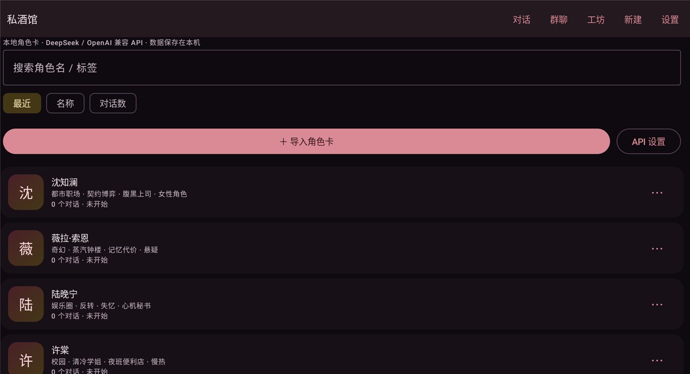
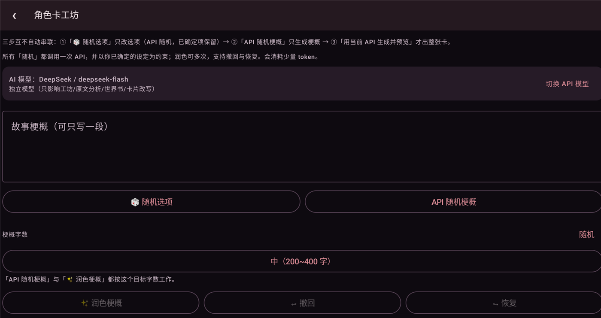

# 私酒馆（DSH Tavern）Android v1.9.5

**简体中文** | [English](README.en.md)

[](LICENSE)
[]()
[]()

本地优先的安卓角色卡酒馆：**自己导入/创建角色卡，自己配 API 自己玩**，没有账号、没有社区、没有云同步。
支持 **DeepSeek** 与任意 **OpenAI 兼容 API**（中转站/多供应商），全部数据保存在手机本地。

> 仅限 18 岁以上用户用于虚构创作。

> **⬇️ 下载**：[最新版 APK（点击直达下载）](https://github.com/joker3025/sijiuguan/releases/latest/download/sijiuguan.apk)
> ｜ [版本发布页](https://github.com/joker3025/sijiuguan/releases/latest)
> ｜ 要求 Android 8.0+，debug 签名，侧载安装

---

## 截图

| 角色卡库 | 角色卡工坊 |
| --- | --- |
|  |  |

---

## 一、v1.7 更新（同人/小说原文改编 + 世界书结构校验）

- **长截图切片（v1.9.5）**：长截图不再整体缩小导致「太模糊」——保持原宽度、按纵向切成多张**带重叠**的切片，一次性按顺序发给视觉模型转录（重叠部分不重复）；普通截图仍是一张。
- **视觉读图改两步（v1.9.4）**：先让视觉模型只做「转录文字」（纯文本，最容易成功），再用普通文本模型把转录结果提取成设定/梗概；失败时显示模型实际返回的片段，方便判断是不是「模型看不到图」。
- **精简版：移除本地 OCR（v1.9.3）**：确认视觉 API 可用后，去掉内置 ML Kit 中文 OCR 模型，**APK 从约 51.7MB 回到约 10MB**；图片读卡只走「视觉 API 读图」；分享图片到应用（不是角色卡文件时）也自动改用视觉模型读图并跳工坊。
- **视觉 API 读图（v1.9.2）**：图片读卡新增「视觉 API 读图并提取」：把截图压缩成 JPEG 以 OpenAI 兼容 `image_url`（base64 data URL）发给当前 AI 工具模型，由模型转录图片文字、提取设定并润色梗概；要求模型支持视觉输入，不支持时会弹窗提示。
- **bug 修复 / 体验完善（v1.9.1）**：截图直接「分享到私酒馆」现在会自动回退 OCR 读卡（以前会报“导入失败”）；图片 OCR 增加 90 秒超时与更好的缩放（长截图不易 OOM）；章节范围写反（如 5→3）会自动交换；分享 JSON 不会再被误判成 TXT 原文。
- **从图片读卡（v1.9.0）**：工坊新增「从图片读卡（角色卡介绍截图）」：选一张别人角色卡的介绍/对话截图，**本地 ML Kit 中文 OCR** 识别成文字（不上传图片）→「✨ 提取设定并润色」让 API 修正 OCR 错字、提取角色名/性别/世界观/人设/主线/外貌等可用设定并润色梗概 →「✨ 提取并生成完整卡」直接补全成完整角色卡。介绍里没写的设定由 API 生成。
- **时间点说明更清楚（v1.8.8）**：把「从哪个时间点 / 范围开始做卡」改名为「角色卡从原著的哪个进度开始（时间点 / 范围）」，并在下方加说明：这是原著时间线起点，之前的剧情变背景、之后的不提前写进开场白；范围模式只按区间取材。
- **分析失败可诊断（v1.8.7）**：事件类时间点（某个事件之后 / 事件范围）没填关键词会直接提示而不是发请求；快速压缩输入预算按上下文自适应（最多约 2 万字符）；JSON 解析失败会自动缩短输入 + 降温重试一次；仍失败会弹出**具体错误对话框**（含原因和排查步骤：换模型/拉取模型列表/换模式）。
- **范围感知（v1.8.6）**：选了「章节范围 / 事件范围」后，**快速压缩与逐段精读都只在所选范围内工作**（如 1→100 / 1→150 章：快速压缩只在区间内均匀采样约 2.4 万字；逐段精读只切该区间；仅范围片段也会在区间内采样），不会把整个区间硬塞给模型。
- **范围选择（v1.8.5）**：时间点选择新增 **「章节范围」**（第 X 章 → 第 Y 章）与 **「事件范围」**（从事件 A → 事件 B）；「仅时间点片段」改为 **「仅所选范围片段」**——只发送你圈定的章节/事件区间原文（区间太长会采样截取），最省 token。
- **快速压缩（v1.8.4，默认）**：不再逐段读全本——在全书里按顺序均匀采样约 2.4 万字（含开头/结尾），**一次 API 调用**压缩成重点资料（人物关系/外貌/性格/事件/说话方式/世界观），再据此生成梗概与角色卡。长篇失败/慢/贵的问题从根上解决；「逐段精读」保留为可选项。
- **章节切分修复（v1.8.4）**：兼容「第1 章」（数字与“章”之间有空格）的下载器 TXT 标题——用户那本 655k 字/301 章的书原来只被识别成 5 章，现在能正确切出全部章节。
- **「重点保留」多选（v1.8.3）**：工坊原文区新增多选 chips：人物关系 / 外貌外形 / 性格特点 / 重要经历事件 / 说话方式，另加世界观规则 / 地点势力 / 称呼身份；勾选项会写进全文分段提取、原文分析、生成角色卡、世界书 AI、卡片改写的提示词。
- **全文分析稳定性（v1.8.2）**：全文分段的大小改为按上下文预算自适应（1M→3万字符/段，128K→1.2万，更小→6千），每段输出 token 提高到 2000 并在空返回时缩短段落重试一次；接口若提示「maximum context length is X」会**自动把上下文设置调低**；所有段都失败时自动**回退到时间点片段分析**并提示原因，不再只给一句失败。
- **一键「原文+要求」直接出卡（v1.8.1）**：工坊「原作要求」输入框下方新增按钮「✨ 一键：按原文+要求生成梗概并做卡」：自动全文分析 → 填好梗概/选项/人设 → 自动生成角色卡预览，预览里可改后再导入。
- **全文分析（v1.8.0）**：工坊「原作导入」新增「全文分析 / 仅时间点片段」两种模式，默认全文——整本书按段切分、逐段调 API 提取人物/关系/世界观/事件，汇总成「全书参考」；生成角色卡、世界书 AI、卡片字段 AI 改写都会参考全书参考 + 时间节点附近原文 + 梗概 + 你的要求。长篇会多次调用、消耗较多 token，界面会显示「第 i/N 段」进度。
- **模型切换覆盖所有 AI 编辑界面（v1.7.8）**：角色卡编辑器、世界书条目编辑弹窗、世界书收藏库、全局世界书页顶部都新增「AI 模型：供应商 / 模型」栏 +「切换 API 模型」，与工坊共用同一套工具模型设置。
- **工坊页直接切换 API 模型（v1.7.7）**：角色卡工坊顶部新增「工坊 AI：供应商 / 模型」栏 +「切换 API 模型」按钮，可在工坊内选供应商、填模型 ID、点快捷模型、拉取该供应商 `/models` 并保存；只影响工坊/原文分析/世界书/卡片改写，不影响聊天对话模型。
- **AI 工具模型独立设置（v1.7.6）**：设置 → 供应商新增「AI 工具模型（工坊随机 / 原文分析 / 世界书 / 卡片改写）」，留空跟随对话模型；填写后这些功能单独用该模型（Base URL / Key 仍用当前供应商）。例如对话走 `deepseek-flash`，工坊/原文分析/世界书走 `deepseek-v4.1-flash`。
- **回复字数设置位置**：设置 → 生成参数 →「最低回复字数（0 = 不限制）」（可点 不限制 / 200 / 400 / 600 字快捷按钮）。
- **设置页模型快捷建议更新（v1.7.5）**：设置 → 供应商的模型快捷按钮改为完整列表（`deepseek-flash`、`deepseek-v4-pro`、`deepseek-v4.1-flash`、`deepseek-v4.1-flash-1017`、`deepseek-v4.1`、`deepseek-chat`、`deepseek-reasoner`），并注明「只是快捷填写，不是限制；模型 ID 可手动输入任意型号，以 /models 为准」；新安装默认模型改为 `deepseek-flash`。
- **模型名报错自动修复（v1.7.4）**：接口返回 `400 The supported API model names are ...` 时，应用会解析出可用模型并弹窗，点一下即可**切换模型并自动重试**；非流式请求（工坊/AI 改写/世界书）也会显示同样的友好提示。常用模型列表加入 `deepseek-flash`、`deepseek-v4-pro`（1M 上下文）。
- **文本直链导入 + 系统分享接入（v1.7.3）**：工坊「原作导入」支持粘贴 **TXT/EPUB 直链（http/https）** 直接导入；把 TXT/EPUB 从下载器/文件管理器「分享」或「打开方式」到本应用，会自动识别为原文并进入工坊分析。
  - 说明：番茄/起点等网页需要登录或反爬，应用内**不抓取**；可先用第三方下载器（如 Fanqie-novel-Downloader）导出 TXT，再「选择 TXT」或分享到本应用。

- **工坊原作导入（TXT / EPUB）**：把同人/小说原文导入后：
  - 自动切章节（TXT 支持 UTF-8/GBK；EPUB 解析 spine 章节）；
  - 选择**从哪个时间点开始做卡**：第一章开头 / 最后一章 / 指定第 N 章 / 某个事件之后（输关键词定位）；
  - 「✨ 从原文提取梗概 / 人设 / 外貌」：按时间节点截取原文，用 API 生成梗概、角色名、性别、世界观、人设、主线、题材、基调、外貌，自动填入工坊；
  - 最终「生成角色卡」时，提示词会**同时包含原文节选 + 原作要点 + 你写的梗概 + 额外要求**，并明确要求「外貌/性格/说话方式与原文一致、开场只到指定时间节点、避免 OOC」。
  - 原文只截取片段发给当前 API 供应商，不会上传整本。
- **模型切换列表补全（v1.7.2）**：「切换模型」常用列表现在包含 **deepseek-v4.1-flash / v4.1-flash-1017 / v4.1**（标注 1M 上下文），再往后是 128K 的 deepseek-chat / deepseek-reasoner；当前正在用的模型也会显示，`/models` 拉取到的模型追加在最后。
- **原作要求贯穿全流程（v1.7.1）**：选择 TXT/EPUB 旁新增「原作要求」输入框（哪个角色 / 哪个时间 / 哪个地点 / 其他）；这段要求和原文会贯穿：原文分析提取梗概选项、生成角色卡、卡片编辑器的 AI 改写、世界书 AI 生成/修改——保证角色与配角关系始终贴合原著，方便沉浸式游玩。
- 数据库无变更（v14）。

## 二、v1.6 更新（卡片字段 AI 改写 / 世界书收藏库）

- **卡片编辑器 AI 改写**：任意字段（角色名/详细描述/性格/场景/开场白/系统指令/作者注释/示例/标签/备选开场）选一个，写「你的要求」→ AI 只改这个字段；改完自动做**一致性冲突检查**：
  - 冲突以**黄色文字**列出（哪个字段、什么冲突）；
  - 可选「保留冲突」或「一并修改」（AI 给出的修正建议会一起套用到对应字段）；
  - 编辑器顶部有 **↩ 撤回 / ↪ 恢复**，AI 改写和「一并修改」都能回退/重做。
- **世界书条目 AI 生成/改写**：编辑条目时写要求（如「写亲吻/舌吻的描写」「保留原意更露骨」）→ AI 生成/改写整条（名称/触发词/内容/位置/概率），可再手动改。
- **世界书收藏库（v1.6）**：条目可「★ 收藏」到分组；收藏时可**现场新建分组**；卡片详情/编辑器「从收藏选择」可先选分组、再勾选单条，也支持**全选本组**后批量导入；卡片详情「世界书 → 世界书库」可整组导入或 API 适配导入（保留亲吻/舌吻等指定描写）。编辑器里的世界书条目也支持**开启/关闭开关**。
  - 数据库 v14（新增收藏分组/条目表）。

## 二、v1.4 / v1.5 更新（角色卡工坊 / 花费 / 离线分享包）

- **梗概润色（v1.5.7 / v1.5.8）**：用户自己写的梗概可点「✨ 润色梗概」——按已确定的设定与「额外要求」润色文笔/节奏/钩子，保留主线；**可多次润色**，每次把上一版压栈，可用「↩ 撤回」和「↪ 恢复」前后切换；润色完可点「按当前梗概填写下面的选项」——由 API 从梗概提取性别/尺度/世界观/人设/主线/题材/基调/外貌并填入选项（**只改选项，不改梗概、不生成角色卡**）。
- **工坊草稿不丢（v1.5.8）**：梗概、选项、字数、历史栈全部放在 ViewModel 里；**API 生成卡片失败、切页、旋转都不会清空**你在界面上填的东西。
- **工坊随机全部走 API（v1.5.6）**：不再使用内置固定设定池；每个字段旁的「随机」和整组「🎲 随机选项」都会调用一次 API，并把**你已确定的设定作为约束**（已设的性别/人设/主线/世界观等不会被推翻，AI 只补未设置的项并保持一致性）。
  - 单字段随机：性别/尺度/世界观/人设/主线/题材/基调/外貌/角色名/优先级/世界书规模/标题数量都有各自随机按钮；
  - 整组随机：一次 API 返回 JSON，只补未设置项；
  - 「API 随机梗概」只生成梗概（可选字数），不会自动出卡；③「用当前 API 生成并预览」才出整张卡；
  - 三步互不串联，中途随时可改；会消耗少量 token。
- **离线分享包（v1.5）**：卡片详情「导出 → 导出分享包（卡+聊天记录）」生成**单个 JSON 文件**；对方用「导入角色卡」或本应用任意导入入口选中即可，自动写入：角色卡、世界书、全部聊天记录（含消息时间/用量/多版本）、长期记忆、变量、面板状态、头像图片（base64）。也可以只导出「仅角色卡」。
  - 为什么用 JSON 而不是 PNG：聊天记录放不进 PNG；而且文本 AI 无法直接产出带元数据的 PNG。PNG 继续作为纯卡分发格式。
  - 图片：分享包含应用内保存的头像（导入时压缩到 ≤512px 的图），对方能看到图；原始高清 PNG 文件本身不保留，需要原图请单独发 PNG。
- **花费同步可见**：每条 AI 消息右下角显示本回合 ≈ 金额；聊天页底部新增「本会话 ≈ ¥」，今日花费保留；金额基于接口返回的真实 token × 你填的单价。
- **角色卡工坊**（首页「工坊」）：
  - ①「构思/润色」提示词：把一句话灵感发给任意 AI（GPT/豆包/Grok/Claude/DeepSeek），让它追问并输出卖点、三层人设、关系张力、剧情钩子、开场钩子、标题、世界书大纲；
  - ②「生成角色卡」提示词：内置 **Character Card V3 JSON 完整字段规范**、**分级世界书要求**（T0 常驻规则 / T1 人物地点 / T2 剧情事件 / T3 氛围彩蛋）、**标题套路参考**（含你提供的 18+ 标题示例）、写作要求；
  - ③「立绘/头像」提示词：让 AI 根据卡面写中英文生图提示词，生成图片后在卡编辑器选作头像，导出 PNG 时会嵌入；
  - **粘贴导入**：AI 返回的 V3/V2/裸卡 JSON 直接粘贴解析入库；
  - **直接生成**：用当前 API 生成整张卡并自动导入（会消耗 token，按实际用量计费）。
- **格式建议**：AI 协作统一产 **V3 JSON**（稳定、可编辑、含 character_book 世界书）；**PNG 作为分发格式**——导入后由应用导出，自动嵌入 `chara/ccv3` 元数据与头像。
- **v1.4.1 工坊增强**：
  - 6 个**示例模板**一键填充（古风权谋/都市禁忌/校园反差/西幻/悬疑/末日）；
  - 「外貌要点」独立字段，同时用于 description 与立绘提示词；
  - 生成/粘贴后**先预览再导入**：显示名称、标签、描述/开场白长度、世界书分级条数与**质检提示**（缺名、描述过短、无 T0 常驻、无 keys 条目等）；
  - 预览里可**复制 JSON / 导出 JSON 文件**（备份或继续喂给别的 AI 修改）。

---

## 二、v1.3.2 模型规格适配（DeepSeek V4.1 = 1M 上下文）

- 按官方文档，**DeepSeek-V4.1-Flash 支持 1,000,000 上下文 / 393,216 最大输出**；应用现在能识别 `deepseek-v4.x`、`deepseek-v4.1-flash-*`、`deepseek-flash` 等型号。
- **切换模型自动套用规格**：聊天页「模型 → 切换」后，自动把设置里的「上下文上限 / 单次最大输出」调到该型号规格（V4.1 → 1M / 384K，V3.x/chat → 128K / 64K），并弹提示。
- **老用户自动升级**：启动时若当前模型可识别且上下文仍是旧的默认 65536，自动升到该型号规格。
- **上限放宽**：上下文上限可填到 2,000,000，单次最大输出可填到 393,216；设置页新增 64K/128K/256K/512K/1M 上下文档位与 4K/8K/16K/64K/384K 输出档位。
- **拉取模型列表时读取上下文长度**：`/models` 若返回 `context_length`/`context_window`/`top_provider.context_length`，切换模型时也会自动采用。
- 注：上下文上限只是**本地提示组装预算**，不改变供应商的硬上限；调大后长对话能真的把更多历史/世界书发出去，费用也会随输入 token 增长。

---

## 二、v1.3.1 修复与增强

- **修复回复开头出现一堆 `null`**：部分供应商在流式 delta 里返回 `"reasoning_content": null` / `"content": null`，旧解析把它当成字符串 `"null"` 追加；现在 null 直接忽略，并对旧消息显示做兜底清理。
- **聊天页显示并切换模型**：输入框上方新增「模型：xxx」+ 供应商名，点开可切换供应商/模型、手填模型 ID、拉取模型列表。
- **建议回复随剧情变化**：设置 →「动态建议回复」开启后，每轮回复结束按最近剧情生成 3 条可选回复（关闭则回退到角色卡固定建议）。
- **最低回复字数**：设置 →「最低回复字数」，写进系统提示要求展开描写（0 = 不限制），并自动保证 max_tokens 足够。
- **{{user}} / {{char}} 宏全面生效**：系统提示、角色卡描述/性格/场景/系统指令/示例/作者注释、世界书、历史消息、开场白全部替换；旧消息显示时也会替换。
- **上下文上限说明与快捷档位**：32K/64K/128K/200K 一键切换，并注明只影响提示组装与预算显示，不改模型硬上限。

---

## 二、v1.3 新增（Tavern 进阶能力）

- **跨卡全局世界书**：设置 →「全局世界书」，对所有卡片生效，和卡片世界书一起参与触发/预算；Prompt 诊断里标「全局」。
- **世界书正则触发**：条目可选「触发词按正则匹配」，支持 `下(雨|雪)` 这类写法（非法正则安全忽略）。
- **卡片复制**：卡片库 `⋯` →「复制角色卡」，连同世界书条目一起复制。
- **卡片默认预设**：卡片编辑器可绑定默认预设，新建对话自动使用。
- **变量系统**：卡片可定义初始变量（每行 `名字=值`）；对话里「存档/分支 → 变量」JSON 编辑；`{{变量名}}` 宏会被替换；模型输出 `<setvar name="好感度">35</setvar>` 自动更新并剥离。
- **输出正则后处理**：卡片级「正则 => 替换」规则，清洗 AI 回复正文。
- **多角色同台（群聊）**：首页「群聊」选 2~4 张卡，一个会话里模型同时扮演，用【角色名】分段；世界书合并、记忆/变量/预设照常。
- **应用锁**：PIN 锁（启动需要解锁）；「隐藏最近任务预览」用 FLAG_SECURE 防截屏/录屏。
- 数据库版本 10 → 13，升级自动迁移。

---

## 二、v1.2 新增 / 优化

**修复与体验**
- **PNG 角色卡导出不再丢头像**：头像不是 PNG 会先重编码；导出前清理原图里的 `chara`/`ccv3` 块。
- **明暗主题**：设置 → 外观，可选 深色 / 浅色 / 跟随系统。
- **消息 Markdown 渲染**：粗体、斜体、行内代码、引用、代码块、标题。

**功能**
- **卡片库搜索 + 排序**：按角色名/标签搜索；按最近/名称/对话数排序。
- **全局会话列表 + 消息搜索**：首页「对话」入口，跨所有卡搜标题/角色/消息。
- **导出对话**：聊天页「存档/分支」→「导出对话」生成 Markdown。
- **自动备份 + 备份增强**：每日启动自动备份（保留 7 份）；备份含检查点、面板、预设、记忆、多版本消息。
- **用量统计与预算**：今日/本月 token 与金额、每日预算、聊天页今日花费。
- **自动摘要开关**：可关闭自动摘要并调阈值。
- **互动面板容错**：支持 `<panel>` 与 ```panel 代码块；面板 JSON 可手动编辑/清空。
- **预设增强**：停止序列、frequency/presence penalty；预设导入/导出 JSON。
- **世界书导入/导出**：卡片详情页世界书区独立导入导出。
- **卡片编辑器支持世界书**：编辑卡时直接增删改条目。
- **模型列表拉取 + 自定义请求头**：`/models` 拉模型；每行 `Name: value` 额外 Header。
- **长对话分页**：一次加载最近 200 条，可「加载更早的消息」。
- **Prompt 调试数据清理**：只保留最近 30 条快照。
- **卡片检查**：token 估算 + 缺失字段提醒。
- **一键构建脚本**：`build.ps1`。

---

## 三、v1.1 新增功能（对齐 DZMM 的角色卡游玩工作流）

| # | 功能 | 怎么用 |
|---|---|---|
| 1 | **消息多版本 / 继续写 / 编辑重生成** | 长按角色消息：`重新生成`（旧版保留，气泡里 `‹ 1/2 ›` 切换）、`继续写`、`编辑（存为新版本）` |
| 2 | **Prompt 预览 + 世界书诊断** | 聊天页顶部 `Prompt`；长按角色消息看历史快照；三页签：最终输入 / 世界书 / 预算 |
| 3 | **预设系统** | 设置 →「管理预设」；聊天页 `预设：…` 可单会话切换 |
| 4 | **token 预算 + 真实用量/成本** | 聊天页底部预算条；设置填单价；可关闭 usage 请求 |
| 5 | **长期记忆 / 自动摘要** | 历史变长自动压成前情提要；聊天页 `记忆：…` |
| 6 | **分支 / 检查点 / 带前情开新档** | 长按消息分支/保存检查点；聊天页「存档/分支」 |
| 7 | **世界书增强** | 8 种插入位置、深度、条件概率、辅助关键词、预算 |
| 8 | **互动面板** | 卡片详情配置模板；模型输出面板与剧情选项 |
| 9 | **卡片编辑器 + PNG 导出** | 全部 V3 字段 + 世界书 + 互动模板；PNG 带 `chara`+`ccv3` |

---

## 四、安装

1. 构建 APK（见第七节）或直接用发布包里的 `私酒馆-v1.3.0-debug.apk`；
2. 传到安卓手机，允许「安装未知来源应用」后安装；
3. 系统要求：Android 8.0（API 26）及以上。

> debug 签名仅供个人侧载；如需上架自行配置正式签名。

---

## 五、首次配置（DeepSeek 为例）

打开应用 → 右上角「设置」→「API 供应商」：

| 项目 | 填法 |
| --- | --- |
| 供应商名称 | DeepSeek（随意） |
| Base URL | `https://api.deepseek.com/v1` |
| API Key | 你的 DeepSeek API Key（`sk-...`） |
| 模型 ID | `deepseek-chat`（日常）或 `deepseek-reasoner`（带思考过程） |

点「保存并测试连接」。换中转站填 OpenAI 兼容地址即可；可点「拉取模型列表」选模型；需要额外 Header 的服务按 `Name: value` 每行填。

---

## 六、玩法说明

### 1. 角色卡
- **导入**：首页「＋ 导入角色卡」选 `.png` / `.json`；或从文件管理器/微信/QQ「分享」到本应用。
- **新建/编辑**：首页「新建」或详情页「编辑」（含世界书、变量、输出正则、默认预设、互动模板）。
- **复制**：卡片库 `⋯` →「复制角色卡」。
- **导出**：详情页「导出」→ JSON / PNG；世界书可单独导入导出。
- **卡片检查**：详情页 token 估算与缺失字段提醒。

### 2. 玩
1. 点卡片 →「＋ 新对话」选开场白；
2. 流式输出中可「停止」；
3. 长对话可「加载更早的消息」；
4. 长按消息 = 复制/编辑/重新生成/继续写/分支/检查点/Prompt。

### 3. 世界书
世界书区支持：开关、8 种插入位置、深度、priority、条件概率、辅助关键词、**正则触发**、导入/导出。
设置里可管理**全局世界书**（跨卡共享）。命中详情看聊天页 `Prompt`。

### 4. 变量 / 面板 / 群聊
- **变量**：卡片编辑器定义初始变量；聊天「存档/分支 → 变量」JSON 编辑；`<setvar>` 自动更新。
- **互动面板**：卡片详情配置模板；聊天页显示状态与可点选项；可手动编辑 JSON。
- **群聊**：首页「群聊」选 2~4 张卡；模型用【角色名】分段扮演。
- **应用锁**：设置 → 隐私开启 PIN 锁；「隐藏最近任务预览」防截屏。

### 5. 预设 / 记忆 / 存档 / 导出
- 预设：管理预设、单会话切换、停止序列/惩罚、导入导出；
- 记忆：`记忆：…` 查看/生成/编辑/清空；自动摘要可关；
- 存档：检查点「回到」会删后续消息；「带前情开新档」；
- 导出：存档面板「导出对话」生成 Markdown。

### 6. 用量与备份
- 设置 →「用量与成本」：今日/本月 token 与金额、每日预算；
- 设置 →「数据」：手动/自动备份（保留 7 份），JSON 含检查点/面板/预设/变量不入备份（变量在会话内）。

---

## 七、构建

环境：**JDK 17+**、**Android SDK Platform 34**、**Build-Tools 34.0.0**、**Gradle 8.7**。

### Android Studio（推荐）
1. Android Studio → Open → 选择 `私酒馆-源码`；
2. 等待 Gradle Sync；
3. Build → Build APK(s)；
4. 产物：`app/build/outputs/apk/debug/app-debug.apk`。

### 命令行
```bash
cd 私酒馆-源码
gradle assembleDebug
```
> 源码包不含 `gradlew`；找不到 SDK 时建 `local.properties`。  
> **路径含中文会失败**：换纯英文路径，或 `gradle.properties` 加 `android.overridePathCheck=true`。

### 一键脚本（本机推荐）
```powershell
powershell -ExecutionPolicy Bypass -File .\build.ps1
powershell -ExecutionPolicy Bypass -File .\build.ps1 -OutApk "D:\apk\私酒馆-debug.apk"
```

> ✅ 本版本已在 Windows（JDK 21 + Gradle 8.7 + Android SDK 34）通过 `assembleDebug` 编译；真机自测见 `构建说明.md`。

### 升级说明
- 覆盖安装保留数据：数据库 1 → 13 首次启动自动迁移；
- 升级前建议设置 → 数据 → 导出 JSON 备份。

---

## 八、数据与隐私
- 数据在应用私有目录（SQLite）；API Key 用 Android Keystore AES/GCM 加密；
- 唯一对外请求是你配置的供应商（`chat/completions`，拉模型时 `/models`）；
- 应用锁 PIN 仅存 SHA-256；「隐藏最近任务」用 FLAG_SECURE；
- 备份 JSON 含卡片/世界书/对话/消息版本/预设/记忆/检查点/面板，不含 API Key。

---

## 九、已知限制
- 无云同步、语音、生图；
- 世界书默认字面匹配（可开正则），无递归扫描；
- 互动面板/变量依赖模型输出约定标签，弱模型可能不稳定（有手动编辑兜底）；
- 群聊为「单模型分饰」，不是多个模型各自独立发言；
- 忘记应用锁 PIN 只能清除应用数据；
- 已通过编译，但**未做真机运行验证**。

---

## 十、版本历史
- **v1.3.0**：全局世界书、世界书正则触发、卡片复制、默认预设绑定、变量系统与 `<setvar>`、输出正则后处理、多角色群聊、应用锁与隐藏最近任务；数据库 v13。
- **v1.2.0**：PNG 导出修复、明暗主题、Markdown、卡片库搜索排序、全局会话+消息搜索、导出对话、自动备份、用量统计与预算、自动摘要开关、面板容错、预设参数与导入导出、世界书导入导出、编辑器世界书、模型列表、分页、debug 清理、卡片检查、build.ps1；数据库 v10。
- **v1.1.0**：消息多版本/继续写、Prompt 预览、预设、用量成本、自动摘要、分支/检查点、世界书增强、互动面板、卡片编辑器与 PNG 导出；数据库 v8。
- **v1.0.0**：基础版。

---

## 开源协议

本项目使用 [MIT License](LICENSE) 开源，可自由使用、修改、分发（保留版权声明即可）。  
角色卡内容、小说/原著文本、AI 生成的文本由使用者自行负责；本项目仅提供本地工具，不提供任何内容。

